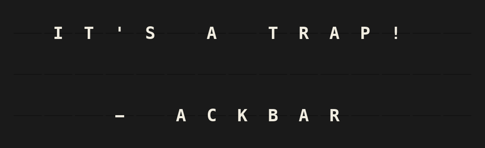

# Lucasfilm Quotes Plugin

A quote from a Lucasfilm movie on the board, a new one on every refresh: word-wrapped, centered, and signed with the character who said it — only quotes that fit the board it is shown on.



## Overview

537 quotes from 23 movies ship with the plugin in [`quotes.json`](quotes.json): nothing is downloaded, no account or API key.

- **Star Wars**: Episodes I–IX, Rogue One, Solo and The Clone Wars
- **Indiana Jones**: all five movies
- **And more**: American Graffiti, Howard the Duck, Labyrinth, Willow, Tucker and Red Tails

Each quote knows its movie and the character who said it, and each character the shorter names they go by. The **Franchises**, **Movies** and **Characters** pickers are built from that.

Only quotes that fit the board are picked, all of them equally likely:

- A **Note** (15×3) gets the short ones, 221 of the 537. Many leave no row for the name, so it is left off rather than the quote cut. With **Character name** set to *Always*, only the 99 that are signed are picked.
- A **Flagship** (22×6) gets nearly all of them, 533, nearly all signed.

Quotes shown in the last 50 refreshes are passed over; once every quote that fits has been shown, the one shown longest ago comes next.

### On a Note (15×3)

```
 IT'S A TRAP!

   - ACKBAR
```

### On a Flagship (22×6)

```
 HOKEY RELIGIONS AND
ANCIENT WEAPONS ARE NO
   MATCH FOR A GOOD
BLASTER AT YOUR SIDE,
         KID.
      - HAN SOLO
```

The layout is computed from the board's size, so any other shape, like a note array or a FiestaPanel grid, gets the quotes that fit its own width and height. A name too long for its row is shortened to the name the character goes by: `- ADMIRAL ACKBAR` becomes `- ACKBAR`, `- OBI-WAN KENOBI` becomes `- OBI-WAN` on a Note.

A quote is signed with the name the character goes by in that movie: Palpatine is `- THE EMPEROR` in Return of the Jedi and `- DARTH SIDIOUS` in Revenge of the Sith. Picking **Palpatine** gets you all of them.

## Template Variables

### Quote

| Variable | Description | Example |
|----------|-------------|---------|
| `{{lucasfilm_quotes.quote}}` | The quote as board text, not wrapped | `IT'S A TRAP!` |
| `{{lucasfilm_quotes.character}}` | The full name of the character, as they go by in the movie | `ADMIRAL ACKBAR` |
| `{{lucasfilm_quotes.movie}}` | The movie the quote is from | `STAR WARS: EPISODE VI - RETURN OF THE JEDI` |
| `{{lucasfilm_quotes.year}}` | The year the movie came out | `1983` |
| `{{lucasfilm_quotes.franchise}}` | The franchise, empty for a movie outside one | `STAR WARS` |

### Board Lines

| Variable | Description |
|----------|-------------|
| `{{lucasfilm_quotes.block}}` | The whole layout, rows separated by newlines. Put it on the first template line. |
| `{{lucasfilm_quotes.line1}}` … `{{lucasfilm_quotes.line6}}` | The same rows one by one, full board width; empty past the board's height |

## Example Templates

### The built-in layout

Put this on the first line of a page, with the line set to left alignment and no wrap. The plugin pads and centers the rows itself:

```
{{lucasfilm_quotes.block}}
```

### Your own layout

The quote, character and movie variables are not wrapped or shortened to the board. `{{lucasfilm_quotes.block}}` is what is laid out for it. For a layout of your own, let the template engine wrap the quote:

```
{{lucasfilm_quotes.quote|wrap}}
- {{lucasfilm_quotes.character}}, {{lucasfilm_quotes.year}}
```

The quote was still chosen to fit the board on its own, so it leaves room for the name line only on a Flagship.

## Configuration

| Setting | Default | |
|---------|---------|---|
| Franchises | any | Only quotes from the movies of these franchises: Star Wars, Indiana Jones. |
| Movies | any | Only quotes from these movies, listed in release order. |
| Characters | any | Only quotes by these characters. |
| Character name | When it fits | Sign the quote with the character's name, shortened to the name they go by when the full one does not fit. **When it fits** leaves it off when the quote needs every row. **Always** picks only quotes with room for it: on a Note 99 of the 221 that fit, or any that fits when none of the chosen quotes has room. **Never** leaves it off. |
| Skip swearing | off | Leave out the handful of quotes with a *damn*, *hell* or *bastard* in them. |
| Alignment | Centered | Centered, with the name centered below; or left-aligned, with the name flush right. |
| Refresh interval | 3600 s | How long a quote stays up. Minimum 60 s: everything happens locally. |

Franchises and movies say where a quote is from, and add up: *Indiana Jones* and *Willow* gives all five Indiana Jones movies and Willow. Characters say who said it, and narrow that down: *Star Wars* and *Yoda* gives Yoda's quotes; *The Empire Strikes Back* and *Yoda* only those from that movie. Characters on their own come from any movie. A selection with nothing short enough for the board shows the shortest of its quotes, cut off with `...`.

No API key, no account, no environment variables.

## Features

- 537 quotes from 23 Lucasfilm movies and 99 characters, shipped with the plugin. Works offline.
- Only quotes that fit: short ones on a Note, long ones too on a Flagship
- Signed with the name the character goes by when the full one does not fit (`- OBI-WAN`, `- VADER`, `- INDY`), and by the name they go by in that movie (`- THE EMPEROR`, `- PRINCESS LEIA`)
- Pickers for franchises, movies and characters, each with how many quotes it brings
- No repeats of the last 50 quotes where it can be avoided
- Board-adaptive, verified by FiestaBoard's geometry conformance suite on every supported board shape

## Author

Oliver Rummeyer

## Development

The plugin imports `src.plugins.base` from the FiestaBoard core, so tests need the core repo checked out next to this one:

```bash
git clone https://github.com/Fiestaboard/FiestaBoard.git ../FiestaBoard

# Import paths matching how FiestaBoard loads the plugin
mkdir -p plugins && touch plugins/__init__.py
ln -sfn .. plugins/lucasfilm_quotes

python -m venv .venv && .venv/bin/pip install pytest pytest-cov requests
PYTHONPATH=".:../FiestaBoard" .venv/bin/pytest tests/ --cov=. --cov-report=term-missing
```

The plugin tests run on a small fixture collection, so a change to the quotes never breaks a test of the layout. The board previews in `manifest.json` are rendered from that fixture, and a test fails if they drift from what the code produces.

### The quotes

[`quotes.json`](quotes.json) holds four lists:

```json
{
  "franchises": { "star_wars":  { "name": "Star Wars" } },
  "movies":     { "return_of_the_jedi": { "name": "Star Wars: Episode VI – Return of the Jedi", "year": 1983, "franchise": "star_wars" } },
  "characters": { "palpatine":  { "name": "Palpatine", "short_names": [] } },
  "quotes":     [ { "character": "palpatine", "movie": "return_of_the_jedi", "text": "Your faith in your friends is yours.", "as": "The Emperor" } ]
}
```

- `franchise` is `null` for a movie outside one.
- `short_names` are the names a character goes by, longest first. The signature takes the longest of the full name and these that fits the row.
- `as` is optional: the name the character goes by in that movie, when not their own. The quote is signed with it, and still found under the character in the picker.

Tests check the file: every quote readable on the board as written, no quote twice in a movie, every franchise, movie and character quoted, and every name fitting a Note in one of its forms.

The quotes were collected from the [Wikiquote](https://en.wikiquote.org/) pages of the movies.

## License

MIT, for the code. The quotes are from movies produced by Lucasfilm Ltd.; Star Wars and Indiana Jones are trademarks of Lucasfilm Ltd. This plugin is not affiliated with or endorsed by Lucasfilm.
